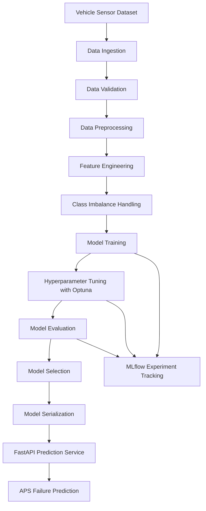
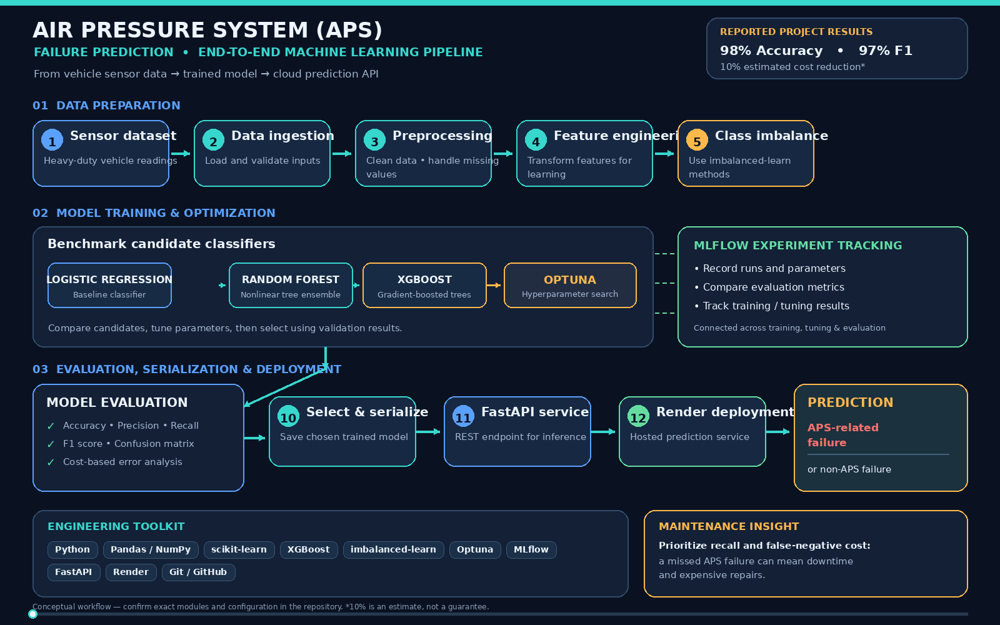

# 🚛 Air Pressure System (APS) Failure Prediction Using Machine Learning

An end-to-end Machine Learning project for predicting Air Pressure System (APS) failures in heavy-duty vehicles using sensor data. The project demonstrates a complete ML pipeline, model benchmarking, hyperparameter optimization, experiment tracking, and cloud deployment through a FastAPI prediction service.

🔗 **Live Demo:** [Try the Deployed Application](https://air-pressure-system-aps-project-using-0efs.onrender.com/)

📂 **GitHub Repository:** [Air Pressure System (APS) Project Using Machine Learning](https://github.com/TusharK93/-Air-Pressure-System-APS-Project-Using-Machine-Learning)

---

## 📌 Project Overview

The Air Pressure System (APS) plays an important role in the operation of braking systems in heavy-duty vehicles. Unexpected APS-related failures can lead to vehicle breakdowns, expensive repairs, operational delays, and increased fleet maintenance costs.

This project uses historical vehicle sensor data to develop a predictive maintenance solution that classifies whether a failure is APS-related or non-APS-related.

The solution covers the complete Machine Learning lifecycle, including data ingestion, preprocessing, class imbalance handling, model training, hyperparameter tuning, experiment tracking, model evaluation, and deployment.

## 🎯 Business Problem

Traditional vehicle maintenance approaches often depend on scheduled inspections or repairs after a failure occurs. These approaches can result in:

- Unexpected vehicle breakdowns and fleet downtime.
- High maintenance and repair costs.
- Delayed identification of potential component failures.
- Inefficient maintenance resource allocation.
- Unnecessary replacement or servicing of healthy components.

**Objective:** Build a reliable classification model that helps identify potential APS-related failures and supports data-driven predictive maintenance decisions.

## 💡 Solution

Developed a production-oriented Machine Learning pipeline that processes vehicle sensor data and predicts APS-related failures.

The solution includes:

- Automated data ingestion and validation.
- Data cleaning and preprocessing.
- Handling of missing values and class imbalance.
- Feature transformation and engineering.
- Benchmarking multiple Machine Learning algorithms.
- Hyperparameter optimization using Optuna.
- Model evaluation and selection.
- MLflow experiment tracking.
- A FastAPI prediction service.
- Cloud deployment on Render.

## ⚙️ Key Features

- **End-to-End ML Pipeline:** Structured workflow from data ingestion to inference.
- **Data Validation:** Validates incoming data before downstream processing.
- **Imbalanced Data Handling:** Uses imbalanced-learn techniques to address class imbalance.
- **Model Benchmarking:** Compares Logistic Regression, Random Forest, and XGBoost.
- **Hyperparameter Tuning:** Uses Optuna to optimize model parameters.
- **Experiment Tracking:** Uses MLflow to record and compare experiments.
- **Centralized Configuration:** Keeps application and pipeline settings organized.
- **Structured Logging:** Improves traceability and debugging.
- **Error Handling:** Provides controlled handling of pipeline and prediction errors.
- **REST API:** Exposes predictions through FastAPI.
- **Cloud Deployment:** Makes the prediction service accessible through Render.

## 🏗️ Machine Learning Architecture

The following diagram illustrates the high-level pipeline.



*The diagram represents the conceptual workflow; the exact implementation may differ from the repository's internal structure.*

## 🛠️ Technology Stack

| Category | Technologies |
|---|---|
| Programming Language | Python |
| Data Processing | Pandas, NumPy |
| Machine Learning | Scikit-learn, XGBoost, Random Forest, Logistic Regression |
| Imbalanced Data | imbalanced-learn |
| Hyperparameter Optimization | Optuna |
| Experiment Tracking | MLflow |
| API Development | FastAPI |
| Database / Data Storage | MongoDB |
| Deployment | Render |
| Development & Version Control | Git, GitHub |
| Engineering Practices | Modular ML pipeline, centralized configuration, structured logging, error handling |

## 🔬 Models Evaluated

The project benchmarks multiple classification algorithms to identify a suitable model for APS failure prediction.

| Model | Purpose |
|---|---|
| Logistic Regression | Baseline classification model |
| Random Forest | Ensemble model capable of learning nonlinear relationships |
| XGBoost | Gradient-boosted tree model for structured sensor data |

Hyperparameter optimization with Optuna helps explore model configurations and improve predictive performance.

The final model should be selected based on evaluation results, including the trade-off between false negatives, false positives, and overall classification performance.

## 📊 Results & Business Impact

The project achieved the following reported evaluation results:

<box border radius="xl" padding={4} gap={3}>
  <grid columns={2} gap={3}>
    <grid-item>
      <text color="secondary" size="sm">F1 Score</text>
      <title size="2xl" color="success">97%</title>
    </grid-item>
    <grid-item>
      <text color="secondary" size="sm">Accuracy</text>
      <title size="2xl" color="success">98%</title>
    </grid-item>
    <grid-item>
      <text color="secondary" size="sm">Estimated Maintenance Cost Reduction</text>
      <title size="xl">10%</title>
    </grid-item>
    <grid-item>
      <text color="secondary" size="sm">Deployment</text>
      <title size="xl">Live on Render</title>
    </grid-item>
  </grid>
</box>

### Business impact

- **97% F1 score:** Demonstrates strong reported classification performance while considering precision and recall.
- **98% accuracy:** Indicates a high proportion of correctly classified examples in the evaluation dataset.
- **10% estimated maintenance cost reduction:** Reported improvement relative to the baseline model using the dataset's cost metric.
- **Automated inference:** Provides a deployed API for making predictions without manually executing the entire training pipeline.

*The metrics are reported project results. The 10% cost reduction is an estimate based on the dataset's cost metric, not a guarantee of real-world savings. Performance may vary with the evaluation methodology and production data.*

## 📈 Evaluation Metrics

The model can be evaluated using the following classification metrics:

- **Accuracy:** Overall proportion of correct predictions.
- **Precision:** Proportion of predicted APS failures that are actual APS failures.
- **Recall:** Proportion of actual APS failures correctly identified.
- **F1 Score:** Harmonic mean of precision and recall.
- **Confusion Matrix:** Helps analyze false positives and false negatives.
- **Cost-Based Evaluation:** Measures the impact of classification errors using the dataset's cost metric.

For predictive maintenance, recall and the cost of false-negative predictions are particularly important because an undetected failure may result in operational downtime and additional expenses.

## 🚀 Live Deployment

The model is deployed as a FastAPI prediction service on Render.

- **Live Application:** [Open APS Failure Prediction](https://air-pressure-system-aps-project-using-0efs.onrender.com/)
- **Source Code:** [View the GitHub Repository](https://github.com/TusharK93/-Air-Pressure-System-APS-Project-Using-Machine-Learning)

The deployed service provides a cloud-accessible interface for model inference. Available endpoints and request formats depend on the implemented API configuration.

## ⚙️ Getting Started

Run the project locally by following these steps.

### Prerequisites

- Python 3.10+ (or the version specified by the project).
- Git.
- Required Python dependencies.
- MongoDB access if required by the configured application.
- The trained model artifacts and configuration files required for inference.

### 1. Clone the repository

```bash
git clone https://github.com/TusharK93/-Air-Pressure-System-APS-Project-Using-Machine-Learning.git

cd -Air-Pressure-System-APS-Project-Using-Machine-Learning
```

### 2. Create a virtual environment

```bash
python -m venv .venv
```

Activate the environment.

**Windows**

```bash
.venv\Scripts\activate
```

**macOS / Linux**

```bash
source .venv/bin/activate
```

### 3. Install dependencies

If the repository includes a `requirements.txt` file:

```bash
pip install -r requirements.txt
```

If it uses another dependency manager, follow the instructions provided by the project configuration.

### 4. Configure environment variables

Create a `.env` file if required by the application.

Example template:

```env
MONGODB_URL=your_mongodb_connection_string
MLFLOW_TRACKING_URI=your_mlflow_tracking_uri
```

These variable names are illustrative. Use the actual configuration keys required by your implementation. Configure only the services that the application uses, and never commit credentials to GitHub.

### 5. Run the application

For a FastAPI application, the following command is a common starting point:

```bash
uvicorn app:app --reload
```

Replace `app:app` with the correct module and application instance for your repository.

Open the local API documentation, if enabled, at:

```text
http://127.0.0.1:8000/docs
```

The interactive Swagger UI can be used to inspect available endpoints and submit prediction requests.

## 🐳 Docker Deployment

If the repository includes a `Dockerfile`, build and run the application using Docker.

### Build the image

```bash
docker build -t aps-failure-prediction .
```

### Run the container

```bash
docker run -p 8000:8000 aps-failure-prediction
```

Ensure the container's startup command binds the FastAPI server to `0.0.0.0` and uses the correct port for your configuration.

## 🔮 Future Enhancements

Potential improvements include:

- Real-time vehicle sensor data integration.
- Model drift detection and automated retraining.
- Advanced experiment tracking and model version management.
- Production monitoring and inference logging.
- Explainable AI techniques for understanding model predictions.
- Threshold optimization based on operational failure costs.
- Integration with fleet maintenance management systems.
- Automated model performance and data-quality alerts.

## 🎓 Skills Demonstrated

- Supervised Machine Learning and binary classification.
- Data preprocessing and feature engineering.
- Imbalanced dataset handling.
- Model benchmarking and evaluation.
- Hyperparameter optimization with Optuna.
- MLflow experiment tracking.
- FastAPI and REST API development.
- Modular pipeline design and configuration management.
- Logging, exception handling, and reproducible experiments.
- Model deployment and cloud-based inference.
- Git, GitHub, and Docker-based workflows.

## 💼 Why This Project Matters

Predictive maintenance is an important application of Machine Learning in automotive engineering, transportation, manufacturing, and fleet management.

This project demonstrates how sensor data and classification models can support earlier failure detection, more informed maintenance decisions, and improved operational efficiency.

It also combines ML experimentation with software engineering and deployment practices, making it a valuable portfolio project for **Machine Learning Engineer, Data Scientist, and MLOps Engineer** roles.

## 👨‍💻 Author

**Tushar K**

- GitHub: [@TusharK93](https://github.com/TusharK93)

## 📄 License

No license has been specified in this README. Add a `LICENSE` file to the repository if you intend to distribute the project under an open-source license.

---

⭐ If you find this project interesting, consider starring the repository!

**Built with Python, Scikit-learn, XGBoost, Optuna, MLflow, and FastAPI for data-driven predictive maintenance.**
<p align="center">
  
</p
